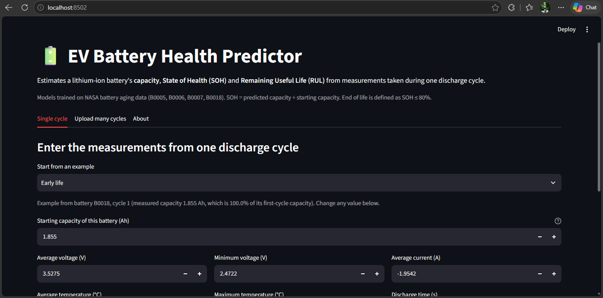
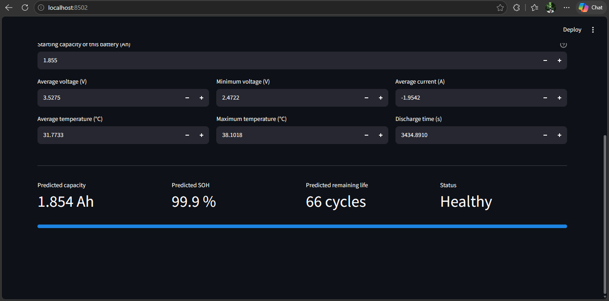
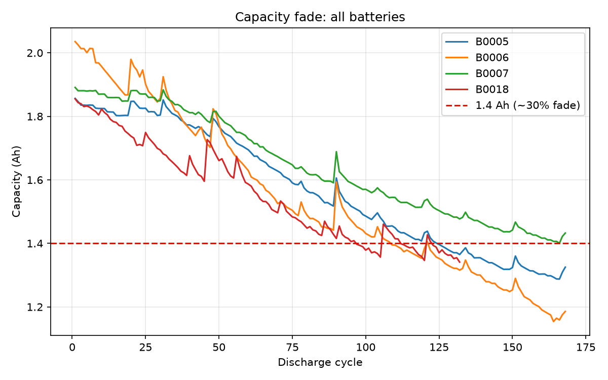
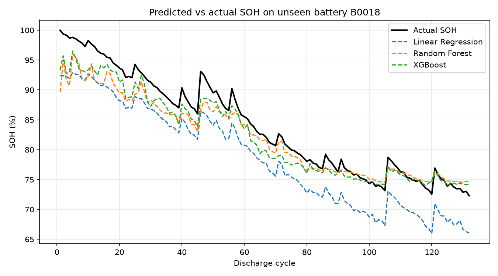
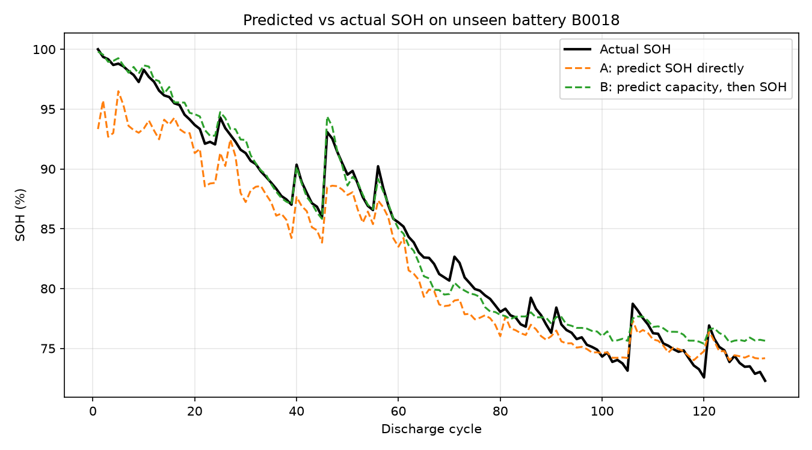
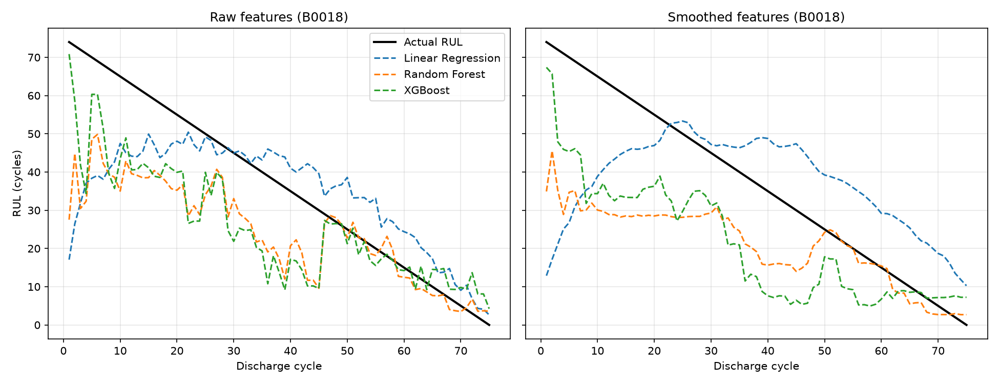
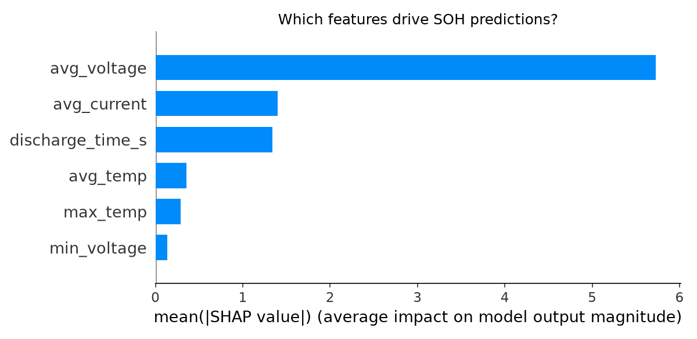
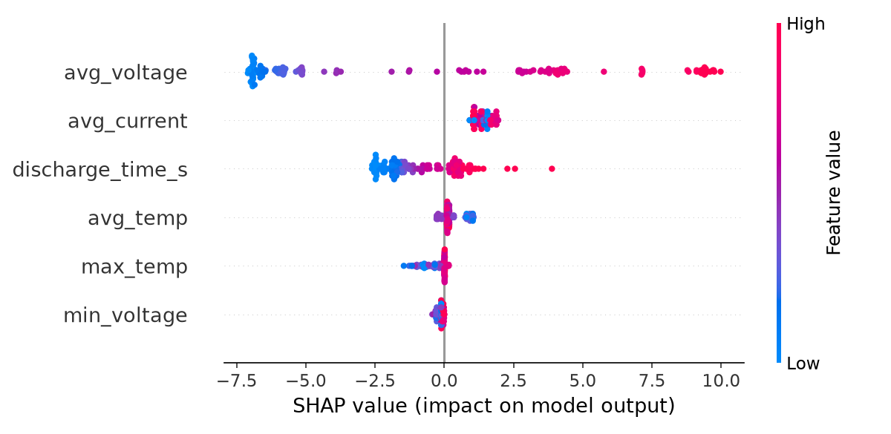

# 🔋 EV Battery Health Predictor

Predicts a lithium-ion battery's **capacity**, **State of Health (SOH)** and **Remaining Useful Life (RUL)** from the measurements of a single discharge cycle, and serves the predictions in a small Streamlit web app.

🔗 **Live app:** [BatteryHealth](https://ev-battery-health-rxtyr4kezt79ceafe8jdw6.streamlit.app/)




## Why this project

An EV battery slowly loses capacity as it ages, and the usual way to measure that is a full capacity test, which is slow. This project asks: **can the health of a battery be estimated from the voltage, current, temperature and discharge time of one cycle?**

It builds on my electrical engineering background (EV and IoT projects) and applies a full data science workflow to real battery aging data: cleaning, exploration, modelling, explainability, deployment.

## Dataset

[NASA Prognostics Center of Excellence, Li-ion Battery Aging Dataset](https://www.nasa.gov/content/prognostics-center-of-excellence-data-set-repository). 18650 lithium-ion cells (rated about 2 Ah) were charged and discharged in a lab until they wore out. I used four batteries: **B0005, B0006, B0007 and B0018**, with 636 discharge cycles in total.

For every discharge cycle I summarised the raw voltage, current and temperature readings into six features:

| Feature | Meaning |
|---|---|
| `avg_voltage`, `min_voltage` | Average and lowest terminal voltage |
| `avg_current` | Average discharge current |
| `avg_temp`, `max_temp` | Average and peak temperature |
| `discharge_time_s` | Length of the discharge |

**Targets:** capacity (Ah), SOH (%) = capacity ÷ starting capacity × 100, and RUL = cycles left until SOH reaches 80% (the usual EV end-of-life line).



## Approach

| Step | Notebook | What I did |
|---|---|---|
| 1 | `step1_load_data.ipynb` | Read the NASA `.mat` files, kept discharge cycles, calculated SOH, plotted capacity fade |
| 2 | `step2_eda.ipynb` | Combined four batteries, checked data quality, explored features and correlations |
| 3a | `step3a_train_model.ipynb` | Trained Linear Regression, Random Forest and XGBoost to predict SOH |
| 3b | `step3b_target_comparison.ipynb` | Tested whether predicting capacity first works better than predicting SOH directly |
| 4 | `step4_shap_explain.ipynb` | Explained the model with SHAP |
| 5 | `step5_rul_prediction.ipynb` | Predicted Remaining Useful Life |
| 6 | `step6_streamlit_app.ipynb` | Saved the final models and built the app |

**Honest evaluation.** I split by **battery**, not by random rows. Consecutive cycles of one battery are almost identical, so a random split would leak the answers. Models train on B0005, B0006 and B0007 and are tested on **B0018, which they never saw**. I also repeated the SOH comparison with every battery held out in turn.

## Results

### 1. Predicting SOH directly (held-out battery B0018)

| Model | MAE (SOH points) | RMSE | R² |
|---|---|---|---|
| Linear Regression | 5.32 | 5.36 | 0.58 |
| Random Forest | 2.13 | 2.80 | 0.89 |
| **XGBoost** | **1.88** | **2.32** | **0.92** |



The tree models follow the real curve, including the small bumps, but they **under-predict early life** (by about 3.5 SOH points over the first 20 cycles).

### 2. A better way to define the target

SOH is measured against each battery's own first cycle, so every battery starts at exactly 100%, even though the batteries really start at different capacities (B0006 starts at 2.04 Ah, the others at about 1.86 to 1.89 Ah). That blurs the labels. Predicting **capacity in Ah** first, and converting to SOH afterwards, fixes most of it:

| Target | MAE on B0018 (SOH points) | RMSE | Early-life bias (first 20 cycles) |
|---|---|---|---|
| SOH directly | 1.88 | 2.32 | −3.5 |
| **Capacity, then SOH** | **0.87** | **1.12** | **+0.4** |

Repeating this with each battery held out in turn:

| Held-out battery | SOH directly (MAE) | Capacity first (MAE) |
|---|---|---|
| B0005 | 1.26 | 1.69 |
| B0006 | 7.58 | 2.20 |
| B0007 | 1.92 | 1.07 |
| B0018 | 1.88 | 0.87 |
| **Average** | **3.16** | **1.46** |

The capacity-first method is clearly better on average, and especially for B0006, but it is **not better for every battery** (B0005 got slightly worse). The app uses this method.



### 3. Remaining Useful Life

| Features | Model | MAE (cycles) | RMSE | R² |
|---|---|---|---|---|
| Raw | Linear Regression | 10.95 | 15.23 | 0.51 |
| Raw | Random Forest | 13.32 | 17.21 | 0.37 |
| Raw | XGBoost | 12.84 | 15.92 | 0.46 |
| Smoothed | Linear Regression | 15.79 | 19.83 | 0.16 |
| Smoothed | Random Forest | 16.10 | 20.58 | 0.10 |
| Smoothed | XGBoost | 16.39 | 18.84 | 0.24 |

A naive baseline that assumes every battery lasts the average number of cycles of the others (about 95) is off by **20.3 cycles** on B0018, so the models do beat it, but only modestly. RUL is much harder than SOH: the models are noisy early in life and improve near end of life. Smoothing the features over several cycles made things **worse**, not better.



### 4. What does the model rely on? (SHAP)

SHAP was run on the XGBoost model that predicts SOH directly (Step 4).

| Feature | Mean \|SHAP\| (SOH points) |
|---|---|
| `avg_voltage` | 5.73 |
| `avg_current` | 1.40 |
| `discharge_time_s` | 1.34 |
| `avg_temp` | 0.36 |
| `max_temp` | 0.29 |
| `min_voltage` | 0.13 |

Average voltage dominates, followed by current and discharge time. Removing `min_voltage` barely changes the error (1.88 to 1.89), while removing `avg_current` makes it worse (1.88 to 2.17).





## The app

Built with Streamlit. It has three tabs:

- **Single cycle:** enter the six measurements and the battery's starting capacity (or pick an early, mid or late life example) and get the predicted capacity, SOH, remaining cycles and a health status. It warns when an input is outside the range the model was trained on.
- **Upload many cycles:** upload a CSV (or use the built-in sample) to get SOH and RUL curves and a downloadable table.
- **About:** how it works, and its limits.

The app's final models are trained on **all four batteries**, so their own accuracy cannot be measured. All accuracy numbers above come from the held-out tests.

## Limitations

- **Very small dataset:** four batteries from one lab. Treat this as a proof of concept, not a tool for real vehicles.
- **One test battery for most results.** The leave-one-battery-out check helps, but four batteries is still very little.
- **SOH depends on the starting capacity.** If the rated capacity (2.0 Ah) is used instead of the battery's real first-cycle capacity, every SOH value shifts. For B0018 that is about 7 points.
- **Discharge time is nearly the same information as capacity.** Inside each battery their correlation is about 0.98 to 0.99. A real vehicle rarely completes a full discharge, so the model is less practical than the lab numbers suggest.
- **RUL is weak,** especially early in a battery's life.
- **Lab conditions, not real driving.**
- The 80% end-of-life line is a convention.

## Run it yourself

```bash
git clone https://github.com/vrshy/<your-repo-name>.git
cd <your-repo-name>
python -m pip install -r requirements.txt
python -m streamlit run app.py
```

To re-run the notebooks from the start, download the NASA battery data ([direct download](https://phm-datasets.s3.amazonaws.com/NASA/5.+Battery+Data+Set.zip)), unzip it, extract the first inner zip (`BatteryAgingARC-FY08Q4`), and copy `B0005.mat`, `B0006.mat`, `B0007.mat` and `B0018.mat` into the `data/` folder. Then run the notebooks in order. The processed table `all_batteries.csv` is already included, so notebooks 3 onwards work without the raw files.

## Project structure

```
├── app.py                  Streamlit app
├── requirements.txt
├── all_batteries.csv       Per-cycle features for the four batteries
├── sample_input.csv        Example input for the upload tab
├── models/                 Saved XGBoost models and app metadata
├── data/                   Place the NASA .mat files here (not included)
├── images/                 Plots used in this README
├── results/                Result tables (CSV)
└── step1 ... step6         Notebooks, in order
```

## Tech stack

Python, pandas, NumPy, scikit-learn, XGBoost, SHAP, Matplotlib, Streamlit.

## Data citation

B. Saha and K. Goebel (2007). "Battery Data Set", NASA Prognostics Data Repository, NASA Ames Research Center, Moffett Field, CA.

## Author

**Vrshy**, B.E. Electrical and Electronics Engineering. Moving into data science and analytics.
[GitHub](https://github.com/vrshy) · [LinkedIn](https://www.linkedin.com/varshiganesan03)
